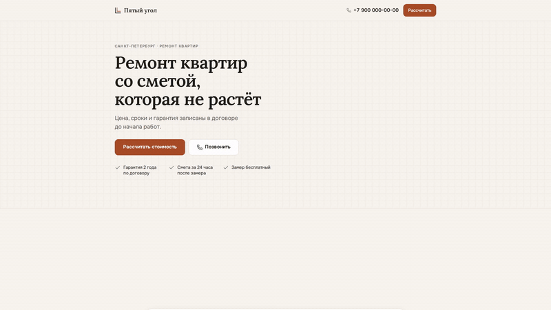
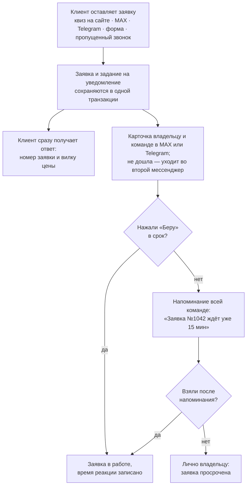
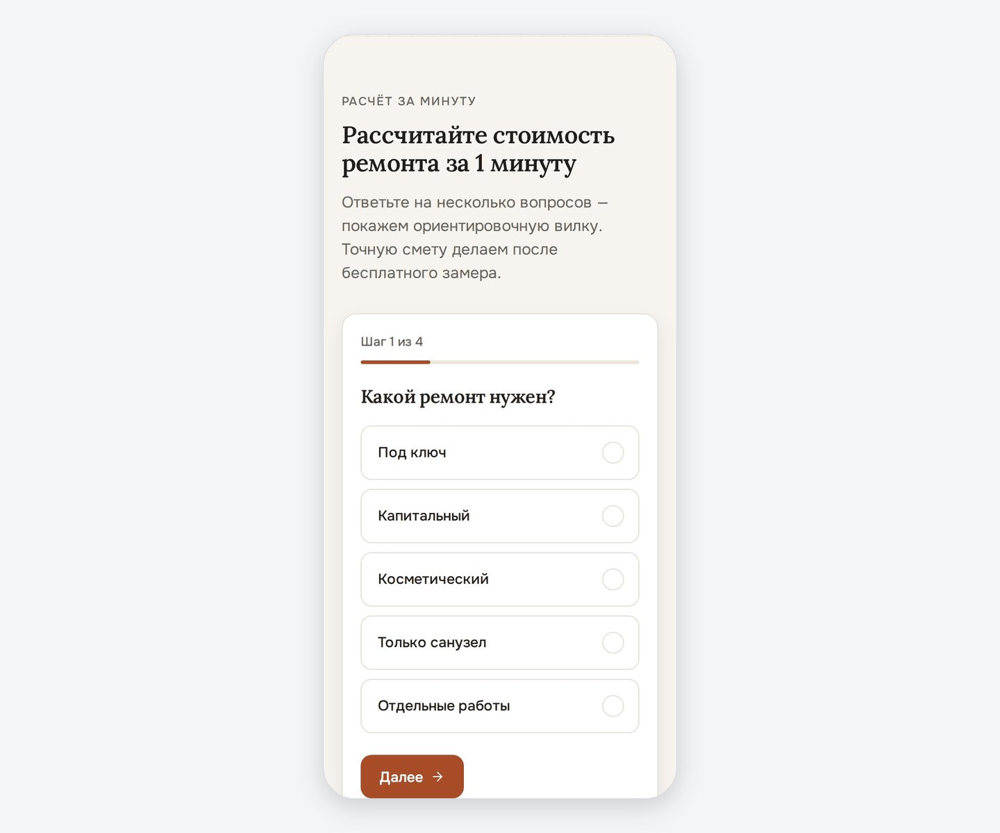
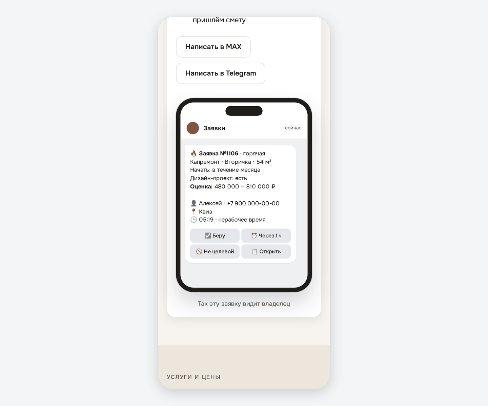
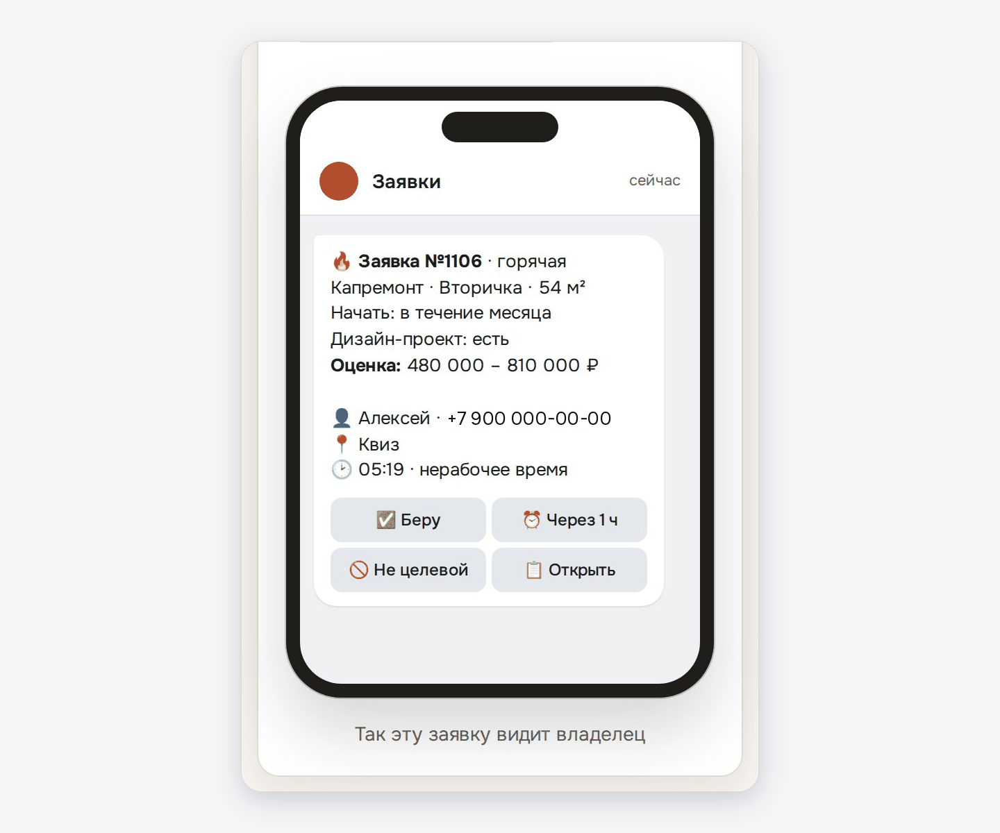
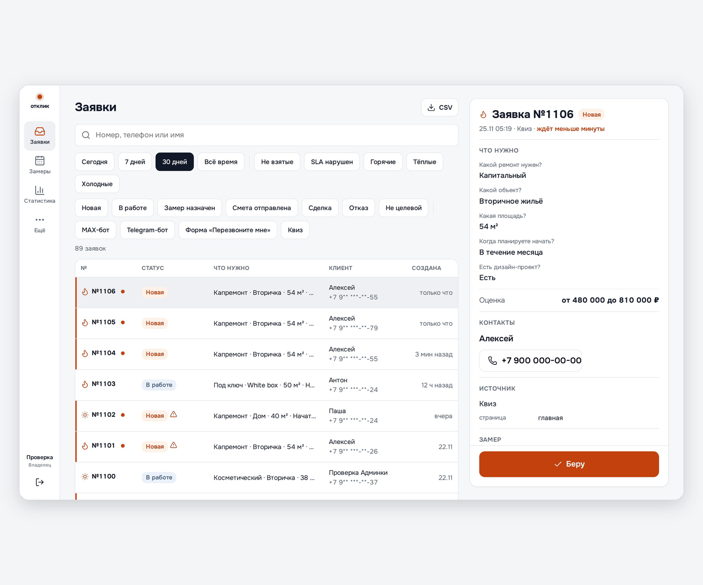
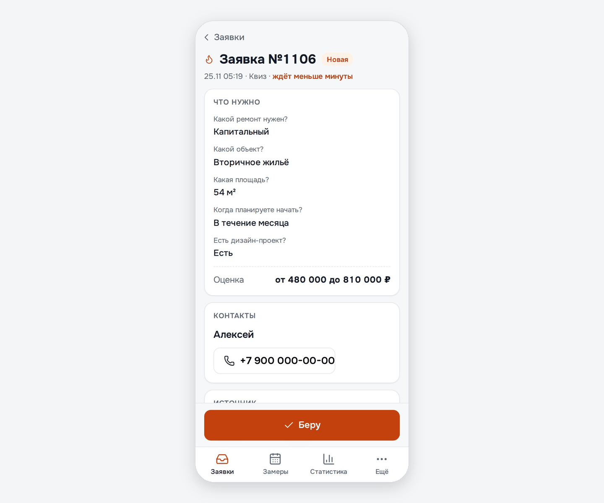
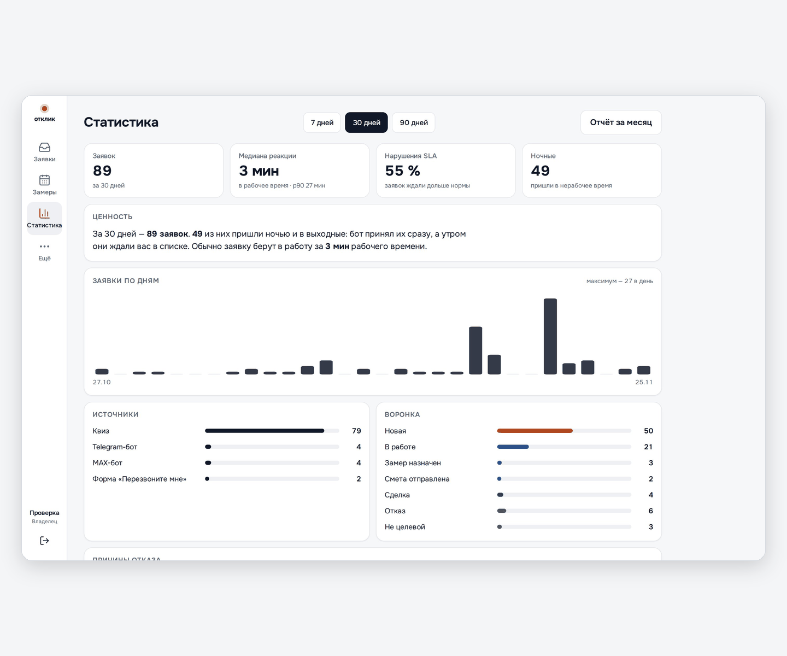
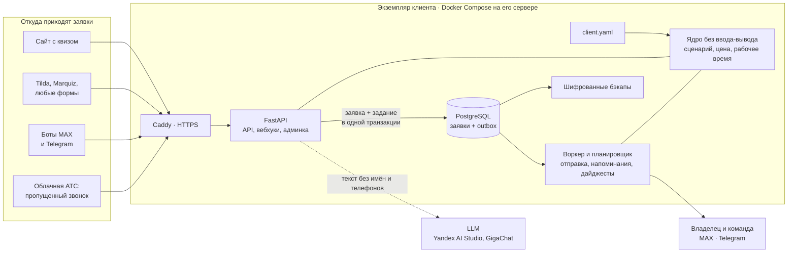

**Русский** · [English](README_EN.md)

# Отклик

Система, которая не даёт терять заявки: ответ клиенту за минуту, карточка владельцу в MAX и Telegram, контроль реакции

**[Живая витрина](https://turtleshell2077.github.io/otklik-showcase/) · [Видео](assets/demo.mp4) · [Связаться](#автор)**

## Какую проблему решает

1. **Клиент уходит к тому, кто ответил первым.** Заявки приходят вечером и в выходные, а владелец на объекте. «Отклик» отвечает клиенту сразу: заявка принята, вот ориентировочная цена, вот когда позвонят.
2. **Заявки теряются по дороге.** Сайт, MAX, Telegram, формы на Tilda и пропущенные звонки сходятся в одну карточку в мессенджере владельца — с телефоном клиента и кнопкой «Беру».
3. **Непонятно, взял ли кто-то заявку.** Система засекает время до «Беру», напоминает команде и пишет владельцу, если заявка ждёт дольше нормы. В статистике видно, сколько заявок пришло ночью и как быстро их берут.

## Как это работает

Срок реакции считается в рабочих минутах: заявка, пришедшая ночью, не превращается в просрочку к утру. Клиенту в это время честно отвечают, когда с ним свяжутся.

## Скриншоты

<table>
  <tr>
    <td align="center" width="50%">
       
      <b>Квиз на телефоне.</b> Вопросы зависят от ответов, после контакта — вилка цены
    </td>
    <td align="center" width="50%">
       
      <b>Витрина владельца.</b> После квиза сайт показывает, как заявку увидит владелец
    </td>
  </tr>
  <tr>
    <td align="center" width="50%">
       
      <b>Карточка в MAX.</b> Резюме, оценка, контакт и кнопки «Беру / Через 1 ч / Не целевой»
    </td>
    <td align="center" width="50%">
       
      <b>Список заявок.</b> Фильтры по сроку, статусу, источнику и температуре
    </td>
  </tr>
  <tr>
    <td align="center" width="50%">
       
      <b>Карточка заявки.</b> Ответы клиента, оценка, контакт и «Беру» с телефона
    </td>
    <td align="center" width="50%">
       
      <b>Статистика.</b> Скорость реакции, ночные заявки, источники и воронка
    </td>
  </tr>
</table>

Все данные на скриншотах демонстрационные: вымышленная ремонтная компания «Пятый угол», телефоны заменены заглушками.

## Возможности

**Старт** — чтобы ни одна заявка не потерялась

- квиз-лендинг с вилкой цены или подключение уже работающих форм (Tilda, Marquiz, любая форма с вебхуком);
- мгновенный ответ клиенту с номером заявки;
- карточка владельцу в MAX и Telegram с кнопками «Беру», «Через 1 ч», «Не целевой»;
- контроль реакции: напоминание команде и сообщение владельцу о просрочке;
- ночной режим и тихие часы по графику бизнеса;
- политика обработки данных и согласие на сайте.

**Бизнес** — всё из «Старта», плюс

- боты-квалификаторы в MAX и Telegram: тот же сценарий вопросов, что на сайте;
- админ-панель: заявки, статусы, заметки, сотрудники и роли, выгрузка CSV, удаление персональных данных по запросу, тёмная тема, установка на телефон;
- запись на замер прямо в боте: слоты, подтверждение владельцем, напоминания клиенту;
- статистика: скорость реакции, ночные заявки, источники, воронка;
- утренний дайджест, итоги недели и тревога «сегодня заявок меньше обычного»;
- пропущенный звонок из облачной АТС становится заявкой с тем же контролем реакции;
- исходящие вебхуки с подписью — для CRM и таблиц.

## Архитектура

| Решение | Почему |
|---|---|
| **Заявка и уведомление в одной транзакции (outbox)** | Сохранённая заявка обязательно дойдёт до владельца: воркер повторяет отправку и переживает перезапуск. |
| **Отдельный экземпляр на клиента** | Данные клиентов не смешиваются, а сбой или обновление у одного не задевает остальных. |
| **Конфиг в YAML с ошибками на русском** | Сценарий, цены, тексты и часы работы меняются без программиста, а опечатка останавливает запуск понятным сообщением. |
| **Контроль реакции и эскалация** | Время до «Беру» считается в рабочих минутах; сначала напоминание всей команде, потом — лично владельцу. |
| **Запасной мессенджер** | Если MAX или Telegram недоступен, карточка уходит во второй канал. |
| **Маскирование личных данных перед ИИ** | В модель уходит текст без имён и телефонов, а суммы и обещания в ответе сверяются с прайсом и базой знаний. |

## Качество

- **1104 автотеста:** 909 на backend (ядро и интеграция с настоящим PostgreSQL: атомарность, очередь, миграции), 151 на Vitest, 44 e2e на Playwright — сайт, админка, портфолио, шаблон сайта.
- **Lighthouse mobile 100 / 100 / 100 / 100** — демо-сайт и портфолио.
- **Строгие проверки:** pyright strict для ядра, TypeScript strict, ruff и Biome — без ошибок.
- **Одна логика на сервере и в браузере:** условия квиза и склонение по числу проверяются общими фикстурами в pytest и Vitest.
- **ИИ:** 49 кейсов оценки; на заглушке — 96 % верно понятых намерений, 0 нарушений.
- **Эксплуатация:** восстановление из шифрованного бэкапа проверено, есть диагностика `otklik doctor` и локальная проверка прод-сборки.
- **CI:** GitHub Actions — ruff, pyright, pytest, Biome, tsc, Vitest и проверка актуальности контрактов API. Конфигурация готова; первый прогон — после подключения remote основного репозитория.

## Стек

| Слой | Технологии |
|---|---|
| Backend | Python 3.14, FastAPI, Pydantic 2, SQLAlchemy 2 (async), Alembic, structlog |
| Данные | PostgreSQL 16, очередь outbox на `FOR UPDATE SKIP LOCKED` |
| Мессенджеры | MAX (свой клиент на httpx), Telegram (aiogram) |
| ИИ | Yandex AI Studio, GigaChat, OpenAI-совместимые API — свой тонкий клиент |
| Сайты | Astro, TypeScript, своя дизайн-система и квиз, шрифты без внешних CDN |
| Админка | серверные шаблоны Jinja2, CSS на токенах, строгая CSP, PWA |
| Тесты | pytest, hypothesis, Vitest, Playwright, Lighthouse |
| Деплой | Docker Compose, Caddy (HTTPS), шифрованные бэкапы с ротацией |

## Статус

**Готово** — этапы M0–M12:

- приём заявок с сайта, из MAX и Telegram, с форм Tilda и Marquiz, пропущенные звонки (Zadarma и любая АТС с вебхуком);
- карточки владельцу, «Беру», напоминания и эскалация, ночной режим;
- админ-панель, запись на замер, статистика, дайджесты, исходящие вебхуки;
- деплой на свой сервер, шифрованные бэкапы, диагностика;
- сайт-портфолио, шаблон сайта клиента, скриншоты и видео одной командой.

**В планах:**

- демо-сервер и проверка ботов вживую с телефона;
- ИИ на реальной модели: код готов и работает на заглушке, пакет «ИИ» (свободный текст, ответы по базе знаний, отчёт за месяц) — после проверки на Yandex AI Studio;
- Авито, amoCRM и Битрикс24 — по запросу первого клиента;
- фото из переписки в карточке заявки.

## Автор

**Алексей Малышев** — проектирую и внедряю «Отклик» для сервисного бизнеса.

- MAX: [написать в MAX](https://max.ru/u/f9LHodD0cOKYgKYUB-79BnOZrfAqQjYPuFIh7r63PSzxH7JzxmgAK0zqOJw)
- Почта: [turtleshell2077@gmail.com](mailto:turtleshell2077@gmail.com)

Исходный код закрыт, покажу по запросу.
