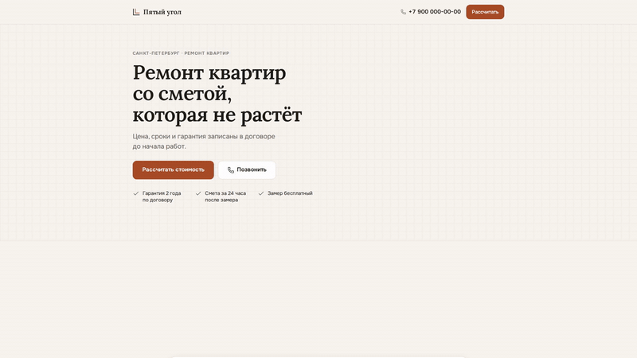
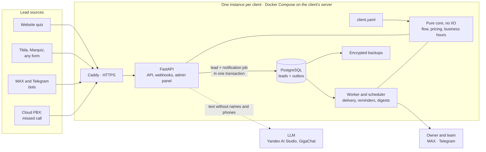

[Русский](README.md) · **English**

# Otklik

A lead-handling system for service businesses: the customer gets a reply within a minute, the owner gets a lead card in MAX and Telegram, and response time is tracked

**[Live showcase](https://turtleshell2077.github.io/otklik-showcase/) · [Video](assets/demo.mp4) · [Contact](#contact)**

## What it does

Small service businesses (the first niche is home renovation in Russia) lose leads that arrive at night, on weekends or while the owner is on site. Otklik:

- **replies to the customer instantly** — lead number and a price range, or an honest "we'll call you tomorrow from 9:00" outside working hours;
- **collects leads from every channel** — website quiz, MAX and Telegram bots, Tilda/Marquiz and other forms, missed calls from a cloud PBX — into one card in the owner's messenger with "Take it / In 1 h / Not a lead" buttons;
- **tracks the reaction** — if nobody takes the lead in time, the team gets a reminder and then the owner is notified personally; the admin panel shows response time, night-time leads, sources and the funnel.

Screenshots and the full feature list are in the [Russian README](README.md#скриншоты).

## Architecture

- **Transactional outbox** — a saved lead always reaches the owner: the worker retries and survives restarts.
- **One instance per client** — client data never mixes; an outage or upgrade affects one client only.
- **YAML config with errors in Russian** — flow, prices, texts and hours change without a developer; a typo stops startup with a clear message.
- **Reaction control and escalation** — counted in business minutes: a reminder to the team first, then a personal alert to the owner.
- **Fallback messenger** — if MAX or Telegram is down, the card goes to the other one.
- **PII masking before the LLM** — the model never sees names or phone numbers; amounts and promises in its answers are checked against the price list and knowledge base.

Quality: 909 backend tests, 151 Vitest, 44 Playwright e2e, Lighthouse mobile 100/100/100/100, pyright strict for the core.

## Stack

| Layer | Technologies |
|---|---|
| Backend | Python 3.14, FastAPI, Pydantic 2, SQLAlchemy 2 (async), Alembic, structlog |
| Data | PostgreSQL 16, outbox queue on `FOR UPDATE SKIP LOCKED` |
| Messengers | MAX (own httpx client), Telegram (aiogram) |
| AI | Yandex AI Studio, GigaChat, OpenAI-compatible APIs |
| Websites | Astro, TypeScript, own design system and quiz, no external CDNs |
| Admin panel | server-rendered Jinja2, token-based CSS, strict CSP, PWA |
| Tests | pytest, hypothesis, Vitest, Playwright, Lighthouse |
| Deploy | Docker Compose, Caddy (HTTPS), encrypted rotated backups |

## Contact

**Alexey Malyshev** — I design and deploy Otklik for service businesses.

- MAX: [message me in MAX](https://max.ru/u/f9LHodD0cOKYgKYUB-79BnOZrfAqQjYPuFIh7r63PSzxH7JzxmgAK0zqOJw)
- Email: [turtleshell2077@gmail.com](mailto:turtleshell2077@gmail.com)

The source code is private; available on request.
